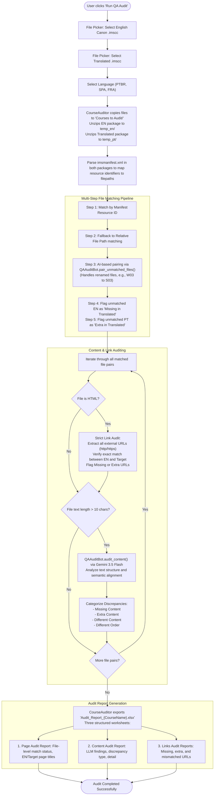
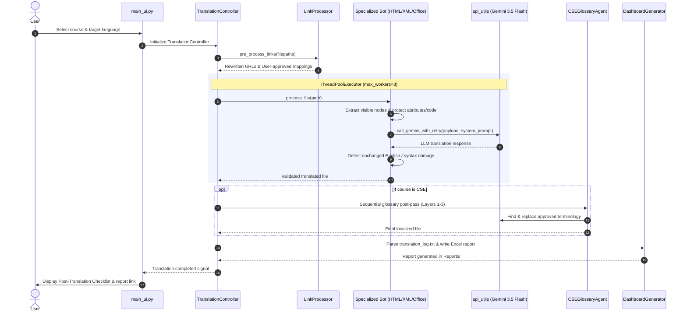
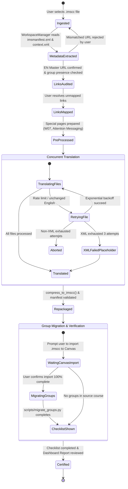

# Course Translation Hub (TranslationHUB) — System Architecture & Flows

The **Course Translation Hub** is a multi-pipeline desktop application built on Python and Tkinter, designed for academic course localization (Portuguese, Spanish, French) across Canvas LMS, EdTech online books, and GitHub-hosted software development textbooks.

---

## 1. High-Level Hub Architecture

The diagram below illustrates the main system entry points, core engines, specialized bots, shared persistent resources, and external services.

```mermaid
flowchart TD
    subgraph UI["Desktop User Interface (app/main_ui.py)"]
        MAIN["CourseTranslationHubUI"]
        ENV[".env & Environment Checker"]
        UPD_BTN["HUB Updates"]
        IMSCC_BTN["Canvas IMSCC Translation"]
        EDTECH_BTN["EdTech Master Translator"]
        GITHUB_BTN["GitHub Translation"]
        AUDIT_BTN["QA Audit"]
    end

    subgraph CORE["Core Orchestration & Controllers"]
        CONTROLLER["TranslationController (app/controller.py)"]
        EDTECH_BOT["EdTechScraperBot (app/bots/edtech_bot.py)"]
        GITHUB_CTRL["GitHubTranslationController (app/github_translation_controller.py)"]
        AUDITOR["CourseAuditor (app/course_auditor.py)"]
        UPDATER["HubUpdater (app/core/hub_updater.py)"]
    end

    subgraph SHARED["Shared Engines & Stores"]
        LINK_PROC["LinkProcessor & link_mapping.json"]
        WS_MGR["WorkspaceManager"]
        GLOSSARY_STACK["General & CSE Glossary Stacks"]
        SCRIPTURE_BOT["ScriptureCheckBot"]
        API_UTILS["call_gemini_with_retry"]
    end

    subgraph BOTS["Specialized Translation & Audit Bots (Gemini 3.5 Flash)"]
        HTML_BOT["HTMLTranslationAgent (Full & Chunked)"]
        XML_BOT["XMLTranslationAgent / QTITranslationAgent"]
        TXT_BOT["TextTranslationAgent"]
        OFFICE_BOT["DOCXTranslationBot & XLSXTranslationBot"]
        MD_BOT["MarkdownTranslationBot"]
        VAR_BOT["VariableExtraction & Analysis"]
        API_BOT["APISettingsAnalysisBot"]
        QA_BOT["QAAuditBot"]
        CSE_AGENT["CSEGlossaryAgent"]
    end

    subgraph EXTERNAL["External Platforms & APIs"]
        GEMINI_API["Google Gemini API"]
        CANVAS_API["Canvas LMS REST API"]
        EDTECH_SITE["EdTech (books.byui.edu via Playwright)"]
        GITHUB_API["GitHub Git & Pages API"]
        PUBLIC_GIT["Master Git Repository"]
    end

    MAIN --> ENV
    MAIN --> UPD_BTN --> UPDATER --> PUBLIC_GIT
    MAIN --> IMSCC_BTN --> CONTROLLER
    MAIN --> EDTECH_BTN --> EDTECH_BOT --> CONTROLLER
    MAIN --> GITHUB_BTN --> GITHUB_CTRL
    MAIN --> AUDIT_BTN --> AUDITOR

    CONTROLLER --> WS_MGR
    CONTROLLER --> LINK_PROC
    CONTROLLER --> GLOSSARY_STACK
    CONTROLLER --> SCRIPTURE_BOT
    CONTROLLER --> HTML_BOT & XML_BOT & TXT_BOT & OFFICE_BOT & CSE_AGENT

    GITHUB_CTRL --> MD_BOT & VAR_BOT & API_BOT
    AUDITOR --> QA_BOT

    BOTS --> API_UTILS --> GEMINI_API
    CONTROLLER --> CANVAS_API
    EDTECH_BOT --> EDTECH_SITE
    GITHUB_CTRL --> GITHUB_API
```

---

## 2. Canvas IMSCC Course Translation Flow

This pipeline handles Canvas Course Cartridges (`.imscc`). It features pre-translation inspections, link localization, special page template handling, concurrent translation, automated recovery, Canvas group migration, and reporting.

```mermaid
flowchart TD
    START(["User clicks 'Select Course & Translate'"]) --> Q_CSE{"Is this a CSE course?"}
    
    Q_CSE -- "Yes" --> CSE_GLOSS["Prompt for optional Course Markdown Glossary"]
    CSE_GLOSS --> STACK_INIT["Load CSEGlossaryStack<br/>1. General glossary.json<br/>2. global-sd-glossary*.md<br/>3. Course Markdown (highest)"]
    Q_CSE -- "No" --> SELECT_FILE
    STACK_INIT --> SELECT_FILE["File Picker: Select .imscc export file"]

    SELECT_FILE --> WS_INIT["WorkspaceManager reads imsmanifest.xml & course_settings/context.xml"]
    WS_INIT --> EXTRACT_ID["Extract source_course_id & canvas_domain"]
    EXTRACT_ID --> PROMPT_EN["Prompt user for Canvas EN Master URL"]
    PROMPT_EN --> VAL_URL{"Entered URL matches package metadata?"}
    VAL_URL -- "Mismatch" --> CONFIRM_URL{"Confirm using entered course ID?"}
    CONFIRM_URL -- "No" --> PROMPT_EN
    CONFIRM_URL -- "Yes" --> CHECK_GROUPS
    VAL_URL -- "Match" --> CHECK_GROUPS["check_course_has_groups(source_course_id) via Canvas API"]

    CHECK_GROUPS -- "Has Groups" --> PROMPT_TARGET["Prompt user for Target Master URL"]
    CHECK_GROUPS -- "No Groups" --> LINK_PHASE
    PROMPT_TARGET --> LINK_PHASE

    subgraph PHASE2["Phase 2: Link Pre-Processing (LinkProcessor)"]
        LINK_PHASE["Scan all HTML and XML files for external URLs"]
        LINK_PHASE --> CLEAN_LINKS["Remove LTI redirect icons<br/>Strip Google /u/n/ account paths<br/>Check ignore domain list"]
        CLEAN_LINKS --> AUTO_RULES["Auto Rules:<br/>- byui-cse -course to -course-pt<br/>- churchofjesuschrist.org append lang=por/spa/fra"]
        AUTO_RULES --> MAP_CHECK{"URL in link_mapping.json?"}
        MAP_CHECK -- "Yes" --> REWRITE_LINK["Replace URL in source content"]
        MAP_CHECK -- "No" --> USER_LINK_PROMPT["Interactive Link Dialog:<br/>User enters localized URL or skips with optional comment"]
        USER_LINK_PROMPT --> ATOMIC_SAVE["Atomic write with process-wide lock to app/link_mapping.json"]
        ATOMIC_SAVE --> REWRITE_LINK
    end

    REWRITE_LINK --> SPECIAL_TEMPLATES

    subgraph SPECIAL["Special Course Page Pre-Processing"]
        SPECIAL_TEMPLATES{"Target is PTBR?"}
        SPECIAL_TEMPLATES -- "Yes" --> W07_CHECK{"W07 Evaluation exists?"}
        W07_CHECK -- "Yes" --> FETCH_W07["Fetch Canvas assignment 816997 from template course 11564<br/>Replace title, HTML, settings, and LTI config<br/>Bypass Gemini translation"]
        W07_CHECK -- "No" --> ATTN_CHECK
        FETCH_W07 --> ATTN_CHECK{"Attention Messaging page exists?"}
        ATTN_CHECK -- "Yes" --> INJECT_ATTN["Copy approved PNGs to web_resources/<br/>Register in imsmanifest.xml<br/>Install approved Portuguese body/title<br/>Bypass Gemini translation"]
        ATTN_CHECK -- "No" --> CONCURRENT_TRANS
        INJECT_ATTN --> CONCURRENT_TRANS
        SPECIAL_TEMPLATES -- "No (SPA/FRA)" --> CONCURRENT_TRANS
    end

    subgraph PHASE3["Phase 3: Concurrent LLM Translation (ThreadPoolExecutor max_workers=3)"]
        CONCURRENT_TRANS["Delegate extracted files concurrently"]
        
        CONCURRENT_TRANS --> FILE_ROUTER{"File Type Dispatch"}
        
        FILE_ROUTER -- ".html" --> HTML_ROUTER{"Page Type"}
        HTML_ROUTER -- "Teaching Notes" --> TN_CHUNK["HTMLTranslationAgent chunk mode<br/>Hardcoded Canvas glossary<br/>Enforce approved title & accordions"]
        HTML_ROUTER -- "Setup Notes" --> SN_CHUNK["Setup Notes prompt override<br/>Translate table cells only<br/>Append: English / Translation"]
        HTML_ROUTER -- "Standard Page" --> STD_HTML["HTMLTranslationAgent<br/>UUID placeholder protection for URLs<br/>Gemini 3.5 Flash translation<br/>Restore URLs, normalize whitespace"]
        
        FILE_ROUTER -- ".xml / .qti" --> XML_TRANS["XMLTranslationAgent / QTITranslationAgent<br/>Max 600 lines per payload<br/>Preserve CDATA and True/False markers<br/>Map Missing to Não Entregue / No Entregado"]
        
        FILE_ROUTER -- ".docx / .xlsx" --> OFFICE_TRANS["DOCXTranslationBot / XLSXTranslationBot<br/>Extract WordprocessingML / SharedStrings<br/>Translate via XMLTranslationAgent<br/>Rebuild in-memory ZIP byte-for-byte"]
        
        FILE_ROUTER -- ".txt" --> TXT_TRANS["TextTranslationAgent plain text translation"]

        TN_CHUNK & SN_CHUNK & STD_HTML & XML_TRANS & OFFICE_TRANS & TXT_TRANS --> ERROR_CHECK{"Worker Succeeded?"}
        ERROR_CHECK -- "Error" --> RETRY_CHECK{"Retries < 3?"}
        RETRY_CHECK -- "Yes" --> EXP_BACKOFF["api_utils exponential backoff retry"] --> FILE_ROUTER
        RETRY_CHECK -- "No (XML/QTI)" --> XML_RECOVERY["Preserve English placeholder in package<br/>Log 'Failed' for manual review dialog"]
        RETRY_CHECK -- "No (Other file)" --> FAIL_RUN["Abort Run"]
    end

    ERROR_CHECK -- "Success" --> POST_CSE{"Is CSE Course?"}
    POST_CSE -- "Yes" --> CSE_AGENT_PASS["Run CSEGlossaryAgent layers (1 to 3)<br/>Find matching terms on EN page<br/>Surgically replace permitted visible text"]
    POST_CSE -- "No" --> PACKAGING
    CSE_AGENT_PASS --> PACKAGING

    subgraph PHASE4["Phase 4: Repackaging & Group Migration"]
        PACKAGING["WorkspaceManager.compress_to_imscc()<br/>Auto-correct nested directories if needed"]
        PACKAGING --> REPORT_GEN["DashboardGenerator: Create '{Course} Translation Report.xlsx'<br/>Tabs: Dashboard KPI, Bot Analysis, Raw Logs, Translated Pages, Translation Review, Office Documents, Link Actions, Commented Links"]
        REPORT_GEN --> CHECK_FAILURES{"Any XML failures?"}
        CHECK_FAILURES -- "Yes" --> SHOW_FAIL_DLG["Display 'Manual Review Required' Dialog<br/>Direct buttons: Open File Location, Open Reports Folder"]
        CHECK_FAILURES -- "No" --> GROUPS_CHECK
        SHOW_FAIL_DLG --> GROUPS_CHECK{"Has Groups to migrate?"}
        
        GROUPS_CHECK -- "Yes" --> WAIT_IMPORT["Dialog: Prompt user to import .imscc into Canvas<br/>Wait for user confirmation (100% complete)"]
        WAIT_IMPORT --> MIGRATE_GROUPS["scripts/migrate_groups.py:<br/>Extract groups from source course<br/>Translate group names<br/>Push to target course shell via Canvas API"]
        GROUPS_CHECK -- "No" --> POST_CHECKLIST
        MIGRATE_GROUPS --> POST_CHECKLIST
    end

    subgraph PHASE5["Phase 5: Post-Translation Quality Checklist"]
        POST_CHECKLIST["Show Post-Translation Checklist Dialog:<br/>1. Import package to Canvas<br/>2. Review Translation Report<br/>3. Verify Setup Notes & Teaching Notes<br/>4. Verify Rubrics & Gradebook<br/>5. Check Tutoring links"]
    end

    POST_CHECKLIST --> DONE(["Process Finished"])
```

---

## 3. EdTech Master Book Translation & Injection Flow

This flow uses **Playwright Chromium automation** to scrape online book chapters from `books.byui.edu`, routes the extracted HTML through the shared translation pipeline, and injects the translated HTML back into the target book shell via CodeMirror.

```mermaid
flowchart TD
    START(["User clicks 'Run EdTech Master Translator'"]) --> SELECT_LANG["Select Target Language (PTBR, SPA, FRA)"]
    SELECT_LANG --> PRE_CHECK["Show Pre-Translation Checklist Dialog:<br/>1. Has target book shell been created?<br/>2. Enter target shell URL (books.byui.edu/...)"]
    
    PRE_CHECK --> VAL_SHELL{"Valid Shell URL?"}
    VAL_SHELL -- "No" --> PRE_CHECK
    VAL_SHELL -- "Yes" --> RESUME_CHECK{"Valid edtech_mapping.json checkpoint exists?"}

    RESUME_CHECK -- "Yes" --> RESUME_BRANCH["Load resumable pages<br/>Skip extraction and translation entirely"]
    RESUME_CHECK -- "No" --> EXTRACT_PHASE

    subgraph EXTRACT["Extraction Phase (EdTechScraperBot)"]
        EXTRACT_PHASE["Launch Chromium via Playwright (fresh non-persistent context)"]
        EXTRACT_PHASE --> GO_TOC["Navigate to target shell #toc"]
        GO_TOC --> FOR_EACH_CH["For each chapter row in #toc"]
        FOR_EACH_CH --> CLICK_EDIT["Click 'a.btn-edit' Edit chapter link"]
        CLICK_EDIT --> READ_TITLES["Read chapter title from contenteditable h1<br/>If #subtitle-container exists, open accordion & read subtitle"]
        READ_TITLES --> SWITCH_HTML["Click HTML role button"]
        SWITCH_HTML --> COPY_CM["Copy complete div.cm-content CodeMirror document via clipboard handler"]
        COPY_CM --> PIGGYBACK["Prepend hidden metadata divs:<br/>&lt;div id='edtech-meta-title'&gt;Title&lt;/div&gt;<br/>&lt;div id='edtech-meta-subtitle'&gt;Subtitle&lt;/div&gt;"]
        PIGGYBACK --> SAVE_RAW["Save to edtech_workspace/raw_html/lesson_N.html"]
        SAVE_RAW --> CLOSE_ED["Close editor via button.btn.bi-x-lg.float-end"]
        CLOSE_ED --> NEXT_CH{"More chapters?"}
        NEXT_CH -- "Yes" --> FOR_EACH_CH
        NEXT_CH -- "No" --> WRITE_MAP["Save initial edtech_mapping.json"]
    end

    WRITE_MAP --> TRANS_PHASE

    subgraph TRANSLATE["Translation Phase (TranslationController)"]
        TRANS_PHASE["Run LinkProcessor (shared link_mapping.json & prompt)"]
        TRANS_PHASE --> CHUNK_BOT["HTMLTranslationAgent chunk mode<br/>Detects edtech-meta-title<br/>Batches visible text nodes (<=6000 chars)<br/>Translates titles, subtitles & body<br/>Unchanged-English retry check"]
        CHUNK_BOT --> GEN_ED_REPORT["Generate '{BookName} EdTech Translation Report.xlsx'<br/>Record Translated vs Failed chapters"]
    end

    GEN_ED_REPORT --> RESUME_BRANCH
    RESUME_BRANCH --> INJECT_PHASE

    subgraph INJECT["Injection Phase (Playwright Automated Injection)"]
        INJECT_PHASE["Google Login / Auth flow in Chromium"]
        INJECT_PHASE --> REMAP_TOC["Remap lesson_N files to live #toc URLs<br/>Validate chapter title identity"]
        REMAP_TOC --> FOR_EACH_TRANS["For each successfully translated chapter"]
        FOR_EACH_TRANS --> OPEN_CHAPTER["Click visible Edit chapter link"]
        OPEN_CHAPTER --> FILL_TITLE["Set contenteditable h1 title<br/>Set contenteditable subtitle (if present)"]
        FILL_TITLE --> PASTE_HTML["Click HTML role button<br/>Paste translated CodeMirror HTML via clipboard Select All / Paste"]
        PASTE_HTML --> SAVE_BTN["Click Save (button.btn.bi-floppy2-fill)"]
        SAVE_BTN --> CLOSE_BTN["Click Close (button.btn.bi-x-lg.float-end)"]
        CLOSE_BTN --> REOPEN_VERIFY["Reopen editor<br/>Verify persisted title, subtitle, and semantic HTML"]
        REOPEN_VERIFY --> NEXT_INJECT{"More translated chapters?"}
        NEXT_INJECT -- "Yes" --> FOR_EACH_TRANS
        NEXT_INJECT -- "No" --> CHECK_FAILS{"Any chapters failed translation?"}
    end

    CHECK_FAILS -- "Yes" --> WARN_FINISH["EdTech Complete With Warnings<br/>(Failed chapters left unchanged in target shell)"]
    CHECK_FAILS -- "No" --> SUCC_FINISH["EdTech Complete Successfully"]

    WARN_FINISH & SUCC_FINISH --> POST_ED_CHECK["Show EdTech Post-Translation Checklist Dialog:<br/>1. Add Cover Image<br/>2. Add CSS in book settings<br/>3. Review EdTech Translation Report"]
    POST_ED_CHECK --> ED_DONE(["Process Finished"])
```

---

## 4. GitHub Textbook Translation & Publication Flow

This flow securely translates GitHub-hosted open educational resources (OER) and software development textbooks (PTBR pilot). It enforces an **approved-delta code model** where code identifiers (variables, functions) are analyzed, protected or translated to Portuguese, while protecting platform and environment contracts.

```mermaid
flowchart TD
    START(["User clicks 'Translate GitHub Repository'"]) --> INPUT_URL["Input GitHub Repo URL or GitHub Pages URL<br/>(e.g., https://github.com/byui-cse/cse340-ww-course-v2)"]
    INPUT_URL --> PARSE_URL["Normalize to canonical GitHub clone URL"]
    
    PARSE_URL --> GLOSS_PROMPT["Prompt for optional Course-Specific Markdown Glossary"]
    GLOSS_PROMPT --> MERGE_GLOSS["Merge 3 Glossary Layers:<br/>1. Glossary/glossary.json (General, lowest)<br/>2. Glossary/sd_glossaries/global-sd-glossary*.md (Middle)<br/>3. Course Glossary (Highest)"]
    
    MERGE_GLOSS --> PROMPT_BRANCH["Prompt for source branch (or use Pages default)"]
    PROMPT_BRANCH --> AUTH_GITHUB["Verify GITHUB_TOKEN & GITHUB_USERNAME from .env"]
    AUTH_GITHUB --> CONFIRM_SAFE["Confirm Safe Translation Dialog<br/>(Explains read-only source and new personal target repo)"]

    CONFIRM_SAFE --> CLONE_SOURCE["Clone source repo to github_workspace/read-only tree<br/>Set push remote to disabled-source-push://read-only"]
    CLONE_SOURCE --> DETECT_SCOPE["Inspect GitHub Pages config (e.g. docs/ folder or root)<br/>Inventory pages: .html, .md, .mdx, .xml, .txt"]

    DETECT_SCOPE --> VAR_PHASE

    subgraph VARS["Variable Analysis & Protection (VariableExtractionBot)"]
        VAR_PHASE["Extract identifier candidates from code blocks, inline code, scripts"]
        VAR_PHASE --> PROTECT_PLATFORM["Seed Protected Platform & Env Identifiers as EN=PT No-Op:<br/>NODE_ENV, PORT, __dirname, process.env.*, import.meta.env, os.environ, getenv"]
        PROTECT_PLATFORM --> GEMINI_VARS["Query Gemini for Brazilian Portuguese identifiers matching source convention<br/>(camelCase, PascalCase, snake_case, UPPER_SNAKE_CASE)"]
        GEMINI_VARS --> VAL_VARS{"Deterministic Identifier Validation"}
        VAL_VARS -- "Collision or Invalid" --> RETRY_VAR["Retry with previous validation error"] --> GEMINI_VARS
        VAL_VARS -- "Valid" --> BUILD_MAP["Build single repository-wide English-to-Portuguese mapping table"]
    end

    BUILD_MAP --> PROSE_TRANS

    subgraph PROSE["Prose Translation & Variable Application"]
        PROSE_TRANS["Translate prose content via MarkdownTranslationBot & HTMLTranslationAgent"]
        PROSE_TRANS --> ROOT_LANG["Enforce target language tag on root &lt;html lang='pt-BR'&gt;"]
        ROOT_LANG --> APPLY_VARS["Apply approved EN-to-PT variable mappings:<br/>- Replace definitions & references in code<br/>- Update linked string references (DOM IDs, selectors)<br/>- In TXT files: restrict to fenced code/raw code"]
    end

    APPLY_VARS --> VALIDATION

    subgraph VALIDATION_PHASE["Content & Syntax Validation (GitHubContentValidator)"]
        VALIDATION["Run Approved-Delta Check:<br/>Code may differ ONLY by validated identifier substitutions"]
        VALIDATION --> PARSER_CHECK["Language-specific code syntax parser<br/>(Dedents standalone Python snippets)"]
        PARSER_CHECK --> BASELINE_CHECK{"Syntax error introduced by translation?"}
        BASELINE_CHECK -- "Yes (Not in source)" --> BLOCK_PUB["Block publication: Critical failure"]
        BASELINE_CHECK -- "No (Passes or baseline match)" --> RESOURCE_INVENTORY
    end

    subgraph REPORTS["Resource Inventory & Report Generation"]
        RESOURCE_INVENTORY["Scan page assets, public hyperlinks, and CSS images"]
        RESOURCE_INVENTORY --> CLASSIFY["Categorize into Packages:<br/>API Setting, Technical Setup Instruction, Canvas, External, GitHub, Video, Image, Codepen"]
        CLASSIFY --> GEN_GH_REPORT["Generate '{Repo} Translation Report.xlsx'<br/>Sheets:<br/>1. Reviewing<br/>2. Variables (actually applied PT identifiers)<br/>3. Resources (Num, Status To Do/Done, Plan Fix Link, Target Language Link, Alt Text)"]
    end

    GEN_GH_REPORT --> PUBLISH

    subgraph PUBLISH_PHASE["Publication to Personal GitHub Account"]
        PUBLISH["Create new public personal repo (e.g. repo-pt or repo-test1-pt)"]
        PUBLISH --> INIT_GIT["Initialize fresh Git history on main<br/>(Excludes source .git and CI workflows)"]
        INIT_GIT --> PUSH_REMOTE["Push to personal GitHub repository"]
        PUSH_REMOTE --> ENABLE_PAGES["Configure and enable GitHub Pages on main"]
    end

    ENABLE_PAGES --> GH_DONE(["GitHub Textbook Successfully Published & Reported"])
```

---

## 5. Quality Assurance Course Audit Flow

The **QA Audit** process compares the English Canon `.imscc` export against a translated `.imscc` export, checking structural integrity, link parity, and semantic content discrepancies.

---

## 6. Translation HUB Auto-Update & Recovery Flows

The application includes an internal fast-forward updater from the master repository and utility recovery tools for failed runs.

```mermaid
flowchart TD
    subgraph UPDATER["HUB Updater Flow (HubUpdater)"]
        START_UPD(["User clicks 'Check for Updates'"]) --> CHK_GIT["HubUpdater checks local Git repository status"]
        CHK_GIT --> CHK_USER{"Configured Git remote belongs to GITHUB_USERNAME?"}
        CHK_USER -- "Mismatch" --> ABORT_UPD["Abort: Security mismatch"]
        CHK_USER -- "Match" --> FETCH_ORIGIN["git fetch origin main"]
        FETCH_ORIGIN --> DIFF_CHECK{"Local commit == origin/main?"}
        DIFF_CHECK -- "Yes" --> UP_TO_DATE["Status: 'Your software is up to date.'"]
        DIFF_CHECK -- "No" --> FAST_FORWARD["git merge --ff-only origin/main"]
        FAST_FORWARD --> RESTART_HUB["restart_hub(): Spawn new process with app/main_ui.py and exit current"]
    end

    subgraph RECOVERY["XML Batch Recovery (app/reprocess_failed.py)"]
        FAIL_DETECT(["TranslationController logs XML/QTI failures"]) --> LOG_ENTRY["Logged to translation_log.txt"]
        LOG_ENTRY --> RUN_REPROCESS["Run python reprocess_failed.py"]
        RUN_REPROCESS --> PARSE_LOG["Parse translation_log.txt for unresolved XML retry failures"]
        PARSE_LOG --> REINIT_CTRL["Re-initialize TranslationController with target workspace"]
        REINIT_CTRL --> RETRY_ONLY["Reprocess ONLY the failed XML/QTI files"]
        RETRY_ONLY --> RECOMPRESS["WorkspaceManager.compress_to_imscc() re-archives final package"]
        RECOMPRESS --> RECOVERED(["Recovery Complete"])
    end
```

---

## 7. Runtime Translation Bot Interaction (Sequence Diagram)

This diagram shows how `TranslationController` coordinates link protection, AI prompts, Gemini retries, and post-processing during file translation:

---

## 8. Canvas Course Package Lifecycle (State Diagram)

This state diagram captures the stages and transition guards an `.imscc` package goes through:

---

## 9. Comparative Feature Matrix Across Translation Pipelines

| Feature / Step | Canvas IMSCC Flow | EdTech Master Flow | GitHub Textbook Flow |
| :--- | :--- | :--- | :--- |
| **Input Format** | Canvas `.imscc` ZIP package | Online book shell URL (`books.byui.edu`) | Public GitHub repository URL |
| **Target Languages** | PTBR, SPA, FRA | PTBR, SPA, FRA | PTBR (Pilot) |
| **Translation Engine** | Concurrent Gemini 3.5 Flash (`max_workers=3`) | Chunked Gemini 3.5 Flash | Gemini 3.5 Flash (Prose + Variable rename) |
| **Link Localization** | `LinkProcessor` + `link_mapping.json` | Shared `LinkProcessor` + `link_mapping.json` | Relative links preserved, external links inventoried |
| **Glossary Stacks** | General (`glossary.json`) + Optional CSE Stack | General (`glossary.json`) | 3-Layer Stack: General + Global SD + Course |
| **Special Content Handling** | W07 Evaluation template, Attention Messaging, Teaching Notes, Setup Notes | Piggybacked hidden title/subtitle divs | Protected platform/env variables, approved-delta code changes |
| **Primary Output** | Localized `.imscc` file + Canvas Group Migration | Injected CodeMirror chapters in target shell | New public personal GitHub repo + GitHub Pages |
| **Generated Report** | `{Course} Translation Report.xlsx` (8 tabs) | `{Book} EdTech Translation Report.xlsx` | `{Repo} Translation Report.xlsx` (3 sheets) |
| **Checkpoint / Recovery** | English placeholder for failed XML + dialog | Persistent `edtech_mapping.json` resume | Publication blocked on syntax/variable errors |

---

*This document was generated based on the architecture and contracts defined in [`app/App_Architecture.json`](file:///c:/Users/vscaran/Desktop/DevProjects/WWOTranslationHUB/app/App_Architecture.json).*

