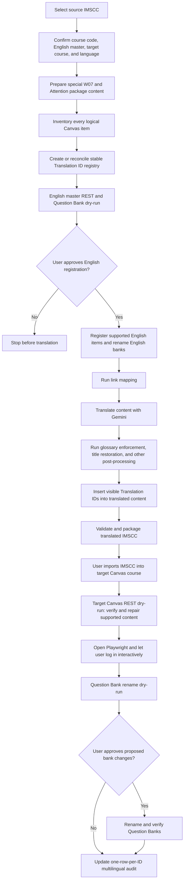

# Translation ID Lifecycle Implementation Plan

Status: Implemented in code; disposable-course staging verification pending  
Date: 2026-11-23  
Scope: new Canvas IMSCC translations, source registration, packaging, target reconciliation, multilingual auditing, and Classic Question Bank renaming

## 1. Objective

Create one permanent, language-neutral identity for every logical Canvas item in a new translation project. Register that identity in the English master, reuse it in every translated course, and produce an audit that compares the same item across English, Portuguese, Spanish, and French.

The system applies to new translations only. It does not backfill previously translated courses in the first release.

IDs must be generated from a complete Canvas/IMSCC inventory, not only from files sent to Gemini. The implementation must avoid exposing IDs to Gemini, duplicating IDs across package component files, or storing the user's Canvas password.

The complete visible ID format is:

```text
TranslationID: {COURSE_CODE}-{TYPE_CODE}-{SEQUENCE}
```

Example:

```text
TranslationID: GS170-PG-001
```

The short registry ID remains:

```text
PG-001
```

## 2. Approved Audit Contract

The following product decisions are approved:

1. The English master receives visible IDs before a new translation begins. Supported Canvas objects are updated through the Canvas REST API.
2. Classic Question Banks in the English master and translated courses are renamed through a credential-safe Playwright flow because the required bank-name operation is not available through the supported REST workflow.
3. Module headers receive registry IDs but are audited from `course_settings/module_meta.xml`; their visible Canvas labels are not changed.
4. External URLs, external tools, module headers, and files receive their own audit rows even when the external destination itself cannot or should not be modified.
5. Files receive their ID in the Canvas display filename through the Files REST API. The default safe format is `Original Name [GS170-FI-001].ext`; the extension is preserved and a colon is not used in the filename.
6. The registry is shared across all languages. A translated course never generates replacement IDs.
7. The audit workbook has one row per Translation ID, with grouped `EN`, `PTBR`, `SPA`, and `FRA` title, URL, presence, and verification fields.
8. The first release covers new translations only.

## 3. Recommended Lifecycle

The workflow has two registration boundaries:

1. Before link mapping, inventory the IMSCC, generate the registry, and register the approved IDs in the English Canvas master. Do not insert visible IDs into the translation workspace yet.
2. After the translated IMSCC is imported, reconcile the target Canvas course and rename its Question Banks.

Recommended flow:



## 4. What Was Missing From the Initial Idea

### 4.1 Complete inventory versus translation inventory

The current translated-pages list is based on files that used Gemini. That is not a complete Canvas inventory. It can omit:

- the canonical PT-BR Attention page;
- the W07 template assignment;
- title-only Canvas objects;
- items bypassing Gemini;
- content represented by more than one IMSCC member;
- Question Banks represented by QTI object banks;
- files and syllabi that use different storage structures.

Translation IDs must come from a new logical-item inventory, not `get_gemini_translation_pages()`.

### 4.2 Stable IDs across reruns

IDs cannot be regenerated solely by current alphabetical position. Adding a page would otherwise renumber later pages.

The registry must:

- reuse an existing ID when the item already has one;
- key items by stable Canvas/IMSCC identifiers where possible;
- assign new items the next unused number for that type;
- never reuse retired IDs;
- never renumber an existing item;
- stop on duplicate or conflicting IDs.

### 4.3 Gemini protection

Visible IDs should not be inserted before translation. Otherwise Gemini could translate, remove, reformat, or duplicate them.

The controller should generate the registry before link mapping, translate normally, and insert the visible markers only after all model-driven processing is complete.

### 4.4 Question Bank title restoration

`TranslationController._preserve_question_bank_titles()` currently restores the exact English source bank names after translation. If bank IDs are inserted before this method, they will be removed.

Question Bank IDs must be appended after `_preserve_question_bank_titles()` or that method must be changed to restore the approved English name plus the registered Translation ID.

### 4.5 Import boundary

The target course's numeric page, assignment, quiz, discussion, module-item, file, and Question Bank records do not exist until Canvas finishes the import.

Post-import API and Playwright work must wait until:

- the user has imported the generated IMSCC;
- Canvas reports the import as complete;
- the user confirms that the target course is ready;
- the controller knows the target Canvas domain and course ID.

The current UI only waits for manual import when groups are present. Translation ID reconciliation requires an import checkpoint even when a course has no groups.

### 4.6 Credentials and browser state

The user's password must never be collected, logged, added to `.env`, or written by the application.

Playwright must open a visible browser and pause while the user completes the normal Canvas/SSO login. Session cookies may be retained only in a dedicated local runtime profile that is ignored by Git.

### 4.7 Rollback and idempotency

Canvas does not provide one transaction covering all items. Every live change therefore needs:

- a dry-run phase;
- a backup of the original value;
- an exact proposed value;
- a write result;
- a read-after-write verification;
- a restoration path.

### 4.8 English-master registration

The English course is not merely a lookup source. It is the canonical first language instance and must be registered before translation:

- supported visible content through the Canvas REST API;
- file display names through the Files REST API;
- Classic Question Bank names through Playwright;
- module-header identity through the package registry and `module_meta.xml` audit evidence.

The source registration must finish and verify successfully before link mapping or translation begins. A partial source registration is a blocking state until it is repaired or rolled back.

### 4.9 Language-neutral auditing

A registry scoped to only one target language cannot support later cross-language auditing. The canonical record must own the Translation ID and stable source identity; language instances hold course-specific Canvas IDs, URLs, titles, and verification results.

## 5. ID Standard

### 5.1 Format rules

- Visible marker: `TranslationID: GS170-PG-001`
- Registry ID: `PG-001`
- Course code: uppercase letters and numbers with no spaces.
- Item code: exactly two uppercase letters.
- Sequence: exactly three digits, starting at `001`.
- Marker text is plain text with no custom styling.

### 5.2 Type codes

| Code | Logical Canvas item type |
|---|---|
| `AN` | Announcement |
| `AS` | Assignment |
| `AG` | Assignment Groups |
| `CM` | Course Metadata |
| `CS` | Course Settings |
| `DI` | Discussion |
| `ET` | External Tool |
| `EU` | External URL |
| `FI` | File |
| `FM` | File Metadata |
| `GS` | Grading Standard |
| `MM` | Media Metadata |
| `MO` | Modules |
| `PM` | Package Manifest |
| `PG` | Page |
| `QB` | Question Bank |
| `QZ` | Quiz |
| `RU` | Rubric |
| `SY` | Syllabus |

### 5.3 Logical-item grouping

One logical item receives one ID even when Canvas represents it with multiple package files.

Examples:

- assignment HTML and `assignment_settings.xml` share one `AS` ID;
- `assessment_meta.xml`, `assessment_qti.xml`, and duplicate non-CC QTI wrappers share one `QZ` ID;
- discussion content XML and `topicMeta` XML share one `DI` ID;
- announcement content XML and `topicMeta` XML share one `AN` ID;
- Question Bank object-bank QTI receives one `QB` ID.

## 6. Registry Data Contract

Create a versioned registry model with one record per logical item:

```json
{
  "schema_version": 2,
  "course_code": "GS170",
  "source_course_id": "442828",
  "languages": ["EN", "PTBR", "SPA", "FRA"],
  "items": [
    {
      "translation_id": "GS170-PG-001",
      "short_id": "PG-001",
      "item_type": "Page",
      "source_title": "Teaching Notes",
      "stable_key": "manifest:gcf8aea23051ebe6e2fbe0c7c68acbf62",
      "package_paths": ["wiki_content/teaching-notes.html"],
      "placement": "html_body_end",
      "instances": {
        "EN": {
          "course_id": "442828",
          "content_id": null,
          "module_item_id": null,
          "title": "Teaching Notes",
          "url": null,
          "presence": "pending",
          "id_status": "pending"
        },
        "PTBR": {
          "course_id": null,
          "content_id": null,
          "module_item_id": null,
          "title": null,
          "url": null,
          "presence": "not_translated",
          "id_status": "not_checked"
        },
        "SPA": {
          "course_id": null,
          "content_id": null,
          "module_item_id": null,
          "title": null,
          "url": null,
          "presence": "not_translated",
          "id_status": "not_checked"
        },
        "FRA": {
          "course_id": null,
          "content_id": null,
          "module_item_id": null,
          "title": null,
          "url": null,
          "presence": "not_translated",
          "id_status": "not_checked"
        }
      }
    }
  ]
}
```

Registry requirements:

- Write atomically.
- Save beside the translation workspace and include its contents in the final report.
- Treat the English instance as canonical while keeping the ID itself language-neutral.
- Add or update a language instance without replacing another language's data.
- Reuse this same registry for every later PTBR, SPA, or FRA run of the course.
- Do not add an unreferenced internal registry file to the IMSCC archive unless Canvas import compatibility is verified.
- Preserve the source registry for rollback and comparison.
- Treat a different existing marker as a conflict, not as permission to overwrite.

## 7. Logical Inventory Rules

Create `TranslationIdRegistryBuilder` to inspect the entire source IMSCC.

Use these sources in priority order:

1. Existing `TranslationID:` markers.
2. `imsmanifest.xml` resource identifiers and referenced files.
3. `course_settings/module_meta.xml` item types and `identifierref` values.
4. Stable hash-directory identifiers for assignments and quizzes.
5. `topic_id` relationships for discussions and announcements.
6. QTI `objectbank` and `bank_title` metadata.
7. Canonical package paths for pages, syllabus, and files.
8. Normalized type plus canonical path only as a final fallback.

`imsmanifest.xml` establishes resources and package relationships. Canvas module headers and module-item structure are stored in `course_settings/module_meta.xml`, so module-header audit evidence must come from that file and be related back to manifest resources where applicable.

Do not use page title alone as a stable key.

The inventory must include special items that bypass Gemini, particularly:

- Attention: Messaging Instructors and Graders;
- W07 End-of-Course Evaluation;
- Setup Notes;
- Teaching Notes;
- Question Banks;
- syllabus;
- every packaged file, including DOCX, PDF, PPTX, images, and other downloadable assets;
- external URLs and external tools;
- module headers and module items.

## 8. Local Package Embedding

Create `TranslationIdEmbedder` with one strategy per logical type.

| Item type | Local insertion rule |
|---|---|
| Page | Final plain paragraph before `</body>` |
| Assignment | Final plain paragraph in assignment HTML |
| Quiz | Final plain paragraph in quiz description |
| Discussion | Final plain paragraph in visible topic text |
| Announcement | Final plain paragraph in visible topic text |
| Syllabus | Final plain paragraph before `</body>` |
| Question Bank | Append marker to the `bank_title` name |
| DOCX file | Final document paragraph before section properties |
| Other downloadable file | Do not change file bytes; assign an ID in the registry and rename the live Canvas display filename through REST |
| External URL/tool | Do not modify the external destination; retain a registry row and audit the Canvas module item |
| Module header | Do not change its visible label; retain a registry row and audit through `course_settings/module_meta.xml` |
| Settings/metadata/duplicates | No separate ID or visible marker when the member belongs to an existing logical item; retain its registry association |

File display-name rule:

```text
Original Name [GS170-FI-001].ext
```

- Preserve the original extension exactly.
- Insert the bracketed ID before the final extension.
- Do not use the literal `TranslationID:` prefix in filenames because `:` is not portable across downloaded files and Windows filesystems.
- If the filename already contains the same bracketed ID, leave it unchanged.
- If it contains a different Translation ID, stop as a conflict.
- Reject a proposed rename that collides with another file in the same Canvas folder.

Embedding must be idempotent:

- correct existing marker: leave unchanged;
- missing marker: insert once;
- different marker: stop and report conflict;
- multiple markers: stop and report corruption.

## 9. Controller Integration

### 9.1 Updated `process_directory()` order

Recommended orchestration:

```python
self.prepare_special_packages()
self.translation_id_registry = self.build_translation_id_registry()
self.register_source_canvas_ids()
self.collect_and_map_links()
self.translate_files()
self.preserve_question_bank_titles()
self.enforce_w07_template_references()
self.embed_translation_ids()
self.validate_translation_ids()
self.workspace.compress_to_imscc(self._log)
```

Detailed order:

1. Extract workspace and course metadata.
2. Ask the user to confirm the Translation ID course code.
3. Prepare special W07 and Attention content so the inventory sees the final logical items.
4. Build/reconcile the complete, language-neutral Translation ID registry.
5. Dry-run, approve, apply, and verify English-master registration through REST and Playwright.
6. Run link mapping.
7. Run Gemini translation and all retries.
8. Run glossary enforcement and deterministic special-page rules.
9. Restore source-exact Question Bank names.
10. Enforce W07 package references.
11. Embed visible IDs from the registry.
12. Validate markers and package structure.
13. Compress the IMSCC atomically.
14. Generate/update the multilingual report and wait for target import.

### 9.2 Why IDs are generated before link mapping

Generating the registry early provides stable identity throughout the run and lets every later phase log against the same ID. Link mapping may change URLs and text but must not change logical identity.

### 9.3 Why IDs are inserted after Gemini

Late insertion keeps Translation IDs completely outside model prompts and responses. It also prevents special post-processing from overwriting markers.

The English master is registered before Gemini, but its content is never used as a model response. The extracted translation workspace still receives its visible markers only after model-driven processing.

## 10. Canvas REST Registration and Reconciliation

Create `CanvasTranslationIdReconciler` for supported public API objects. Use the same service in two modes:

- `source-register`: update and verify the English master before link mapping;
- `target-reconcile`: discover, verify, and repair a translated course after IMSCC import.

The API phase is verification-first, not unconditional mutation:

1. Discover items from the exact approved Canvas course.
2. Match by type plus stable information such as page slug, module relationship, and exact normalized title.
3. Read the current content.
4. Record the original value in a rollback artifact.
5. Classify each item as `Correct`, `Missing`, `Conflict`, or `Unmatched`.
6. Present a dry-run report.
7. Apply only approved `Missing` changes.
8. Read the item again and require exactly one correct marker.

Supported API repairs:

- Pages: `wiki_page[body]`
- Assignments: `assignment[description]`
- Classic Quizzes: `quiz[description]`
- Discussions and announcements: `message`
- Syllabus: `course[syllabus_body]`
- Files: update the File resource's `name` to `Original Name [COURSE-FI-000].ext`

Changing only a Canvas file's display filename does not require downloading or replacing its bytes. Use `PUT /api/v1/files/:id` with `name`, preserve the extension, and verify the returned and subsequently fetched File resource. Before writing, confirm the exact file ID, parent folder, original display name, and absence of a same-folder collision. Do not use an overwrite-on-duplicate option as a shortcut.

The source phase records English Canvas IDs and URLs in `instances.EN`. The target phase writes only the selected target-language instance. Neither phase may replace the canonical Translation ID or another language's instance data.

Do not reuse source-course numeric IDs in the target course. Discover all target IDs after import.

## 11. Playwright Question Bank Renaming

Create `app/scripts/rename_canvas_question_banks.py` as a CLI wrapper around an importable `CanvasQuestionBankRenamer` service.

### 11.1 Timing

Run in both lifecycle positions:

1. For the English master, after the source REST dry-run is approved and before link mapping begins.
2. For a translated course, after the translated IMSCC import is complete and the target course ID is confirmed.

For a target run, require:

- the translated IMSCC is imported;
- the import is complete;
- the target course ID is confirmed;
- the registry and final report are available.

### 11.2 Authentication

- Launch Chromium in visible/headful mode.
- Use a dedicated local persistent profile outside tracked repository data.
- Pause at a login checkpoint while the user enters Canvas/SSO credentials.
- Never request the password through Tkinter, CLI arguments, `.env`, logs, or configuration files.
- Never commit cookies, local storage, browser cache, or session artifacts.
- If the session expires, return to the login checkpoint.
- Provide a UI action to clear the local Canvas browser session.

Recommended runtime profile location on Windows:

```text
%LOCALAPPDATA%\WWOTranslationHUB\playwright\canvas-profile
```

Do not reuse or expand the currently versioned `app/bots/playwright_profile/` directory without first completing its existing cleanup backlog item.

### 11.3 Dry-run behavior

The script must:

1. Navigate to the approved source or target course's Manage Question Banks interface.
2. Enumerate every visible bank and its current name.
3. Load expected bank names and IDs from the registry.
4. Require exact normalized-name matches; do not use fuzzy matching.
5. Detect already-tagged names and skip them.
6. Treat a different existing ID as a conflict.
7. Report missing, duplicate, extra, and non-editable banks.
8. Handle `Unfiled Questions` as a special case and do not force a rename if Canvas disables editing.
9. Show the proposed old-name/new-name table before writes.

### 11.4 Write behavior

For every approved bank:

1. Open the bank's edit-name control using accessible role/name selectors.
2. Replace only the bank name.
3. Save.
4. Wait for Canvas's success state.
5. Reload or reopen the bank.
6. Verify the exact final name.
7. Save a screenshot and audit record.

Expected name format:

```text
QB: GS 170 W01 Level 1 Assessment Questions TranslationID: GS170-QB-001
```

Stop the write run on the first unverified save. Do not continue after an unknown UI state.

## 12. UI Workflow Changes

Update the IMSCC flow in `app/main_ui.py`:

1. Prompt for/confirm the Translation ID course code.
2. Collect and verify the English master Canvas course URL.
3. Add `Enable Translation IDs` checkbox, enabled by default for new translation projects.
4. Show the complete registry summary before any live source write.
5. Run the English REST registration dry-run and require approval.
6. Launch the English Question Bank Playwright dry-run, pause for the user's normal Canvas/SSO login, and require approval before writes.
7. Block link mapping until English registration verifies successfully.
8. Always collect the target Canvas course URL when post-import reconciliation is enabled, not only when groups exist.
9. After packaging, show a manual import checkpoint for every ID-enabled run.
10. Add `Continue After Canvas Import` action.
11. Run target API reconciliation dry-run.
12. Show target API proposed changes and require approval.
13. Launch target Playwright Question Bank dry-run.
14. Require approval before target Question Bank writes.
15. Update the one-row-per-ID multilingual audit and final checklist.

Do not offer automatic backfill of older translations in the first release. A new translation of a course that already has a canonical registry must reuse that registry rather than allocate a second set of IDs.

The UI must remain responsive by running package work, API work, and Playwright orchestration in background threads while all Tkinter dialogs remain on the main UI thread.

## 13. Credential and Secret Handling

### Canvas API

- Continue using `CANVAS_API_URL` and `CANVAS_API_TOKEN` from the ignored root `.env`.
- Never print tokens or include authorization headers in logs.
- Verify the API domain matches the selected source or target course domain before writes.
- Verify the authenticated user can read and edit the exact selected course.

### Playwright login

- The user enters credentials directly in Canvas's visible login page.
- The HUB never reads, stores, or transmits the password.
- Persistent session data remains local and untracked.
- Screenshots must begin only after authentication and must avoid account menus or sensitive profile data.

## 14. Reporting and Rollback

Add a `Translation IDs` sheet to the IMSCC report. Each Translation ID occupies exactly one row; languages are grouped horizontally.

| Field | Purpose |
|---|---|
| Translation ID | Complete stable ID |
| Canvas Item Type | Logical type |
| Canonical English Title | Registry source title |
| Package Paths | All related IMSCC members |
| Local Embed Status | Inserted, already present, skipped, or conflict |
| EN Title / URL / Present / ID Status | English master evidence |
| PTBR Title / URL / Present / ID Status | Portuguese course evidence |
| SPA Title / URL / Present / ID Status | Spanish course evidence |
| FRA Title / URL / Present / ID Status | French course evidence |
| Overall Audit Status | Complete, missing language, ID conflict, unmatched, or not yet translated |
| Original Value Backup | Reference to rollback artifact |
| Detail | Error or verification message |

`Present` distinguishes `present`, `missing`, `not_checked`, and `not_translated`. A language that has not yet been produced is not an audit failure. URLs should be live Canvas links and include `module_item_id` when one is known.

Create a timestamped rollback directory outside the IMSCC containing:

- registry JSON;
- original API content bodies;
- proposed API bodies;
- original and proposed file display names;
- Question Bank old/new names;
- Playwright screenshots;
- final verification results.

Never overwrite a prior rollback directory.

## 15. Proposed Code Changes

### New files

- `app/core/translation_id_registry.py`
  - ID schema, complete logical inventory, stable-key matching, allocation, persistence.
- `app/core/translation_id_embedder.py`
  - HTML/XML/QTI/DOCX insertion and local validation.
- `app/core/canvas_translation_id_reconciler.py`
  - English source registration plus post-import target discovery, dry-run, writes, file display-name updates, verification, and rollback.
- `app/core/canvas_question_bank_renamer.py`
  - Playwright Question Bank discovery, planning, rename, verification.
- `app/scripts/rename_canvas_question_banks.py`
  - Standalone CLI wrapper for dry-run and approved write mode.
- `tests/test_translation_id_registry.py`
- `tests/test_translation_id_embedder.py`
- `tests/test_canvas_translation_id_reconciler.py`
- `tests/test_canvas_question_bank_renamer.py`

### Modified files

- `app/controller.py`
  - Build/reuse the canonical registry and register the English master before link mapping; embed after all translation/post-processing; validate before packaging.
- `app/main_ui.py`
  - Course-code confirmation, target-course collection, import checkpoint, dry-run approvals, login checkpoint.
- `app/core/dashboard_generator.py`
  - Add the one-row-per-ID multilingual Translation IDs report sheet.
- `app/core/workspace_manager.py`
  - Expose validation hooks if required; keep exact archive-member preservation.
- `app/App_Architecture.json`
  - Document the approved Translation ID contract and runtime lifecycle.
- `.gitignore`
  - Ignore any repository-local fallback browser runtime and rollback artifacts if those locations are used.
- `TRANSLATION_HUB_FLOWS.md`
  - Add ID generation, embedding, import reconciliation, and Playwright Question Bank phases.

## 16. Error Policy

### Block package creation

- duplicate Translation IDs;
- one logical item mapped to multiple IDs;
- conflicting existing marker;
- missing required content target;
- malformed modified XML/QTI/DOCX;
- missing manifest reference;
- unexpected mutation of an unrelated package member.

### Block translation start

- English master registration was not approved;
- a required English REST write or verification failed;
- an editable English Question Bank rename failed verification;
- the selected IMSCC does not match the approved English Canvas course;
- an existing canonical registry conflicts with the inventory;
- a new language run attempts to allocate replacement IDs.

### Allow package creation with explicit warning

- live target course is not yet available;
- API reconciliation was deferred;
- Playwright login was cancelled;
- Question Bank is non-editable;
- external URL/tool has no local marker by design.

### Block live writes

- target Canvas domain mismatch;
- target course ID mismatch;
- source course ID mismatch;
- insufficient permissions;
- missing or duplicate live item match;
- dry-run not approved;
- existing different Translation ID;
- failed read-after-write verification;
- unexpected Canvas UI state.

File-specific write blockers:

- proposed filename loses or changes the extension;
- a same-folder display-name collision exists;
- a file cannot be matched to exactly one Canvas File resource;
- a different Translation ID is already present in the display name.

## 17. Testing Strategy

### Unit tests

- deterministic inventory independent of filesystem order;
- existing-ID reuse and next-number allocation;
- no renumbering when a new item is added;
- duplicate and conflict detection;
- special Attention and W07 inclusion;
- assignment/quiz/discussion component grouping;
- marker insertion for HTML, XML, QTI, syllabus, and DOCX;
- Question Bank name append after preservation;
- idempotent second run;
- exact preservation of unrelated package members;
- API payload generation without network calls;
- English source registration planning and idempotent reruns;
- file display-name formatting, extension preservation, and collision blocking;
- language-instance updates that cannot overwrite other languages;
- one-row-per-ID EN/PTBR/SPA/FRA report generation;
- Playwright dry-run matching against static Canvas HTML fixtures;
- `Unfiled Questions` non-editable behavior.

### Integration tests

- run the complete local flow against the GS170 fixture;
- verify every expected logical item and ID;
- verify Gemini payloads contain no `TranslationID:` markers;
- package and validate the IMSCC;
- confirm all manifest references resolve;
- generate the report and rollback artifacts.

### Manual staging-course verification

1. Use disposable English and translated staging courses.
2. Run English REST and Playwright registration; verify all supported items and file display names.
3. Run link mapping and translation, then import the tagged IMSCC into the translated staging course.
4. Confirm pages, assignments, quizzes, discussions, announcement, syllabus, and DOCX markers.
5. Run target API dry-run and confirm it proposes no duplicate changes.
6. Log in through Playwright manually and run the target Question Bank dry-run.
7. Approve renames and verify all editable bank names; report any Canvas-managed bank.
8. Verify one audit row per ID with distinct EN and target-language evidence.
9. Re-run both reconcilers and confirm the process is idempotent.

## 18. Implementation Phases

### Phase 1: Registry and inventory

- Implement the language-neutral schema, complete logical inventory, stable keys, allocation, and registry report.
- Add course-code confirmation.
- Verify Attention, W07, module headers, external items, and every file are included.

### Phase 2: English master registration

- Implement source REST discovery, dry-run, approved writes, file display-name renaming, and read-after-write verification.
- Implement English Classic Question Bank registration through credential-safe Playwright.
- Block translation until the source registration is complete and consistent.

### Phase 3: Local embedding and packaging

- Implement all approved placement strategies.
- Integrate after translation/post-processing and before compression.
- Add blocking package validation and regression tests.

### Phase 4: UI and multilingual reporting

- Add target-course/import checkpoint to all ID-enabled runs.
- Add the one-row-per-ID EN/PTBR/SPA/FRA report sheet and rollback artifact management.

### Phase 5: Target Canvas API reconciliation

- Implement discovery, dry-run, approved writes, and read-after-write validation.
- Verify or repair target file display names without replacing file bytes.

### Phase 6: Target Playwright Question Bank renaming

- Implement secure interactive login and dedicated local profile.
- Implement exact matching, dry-run, write, screenshots, and verification.

### Phase 7: Documentation and rollout

- Update architecture and flow documentation.
- Run full automated suite.
- Complete one disposable staging-course test before enabling production writes.
- Enable the lifecycle for new translations only; defer historical-course backfill.

## 19. Acceptance Criteria

- Every logical item receives one stable registry ID.
- Special non-Gemini items, files, module headers, external URLs, and external tools are included.
- The English master is registered and verified before link mapping begins.
- Supported English visible content is updated through REST; English Classic Question Banks are updated through Playwright.
- IDs do not appear in Gemini requests or responses.
- Visible markers use exactly `TranslationID: COURSE-XX-000`.
- Question Bank markers appear in bank names.
- File display names contain the bracketed canonical ID before the preserved extension.
- A second run produces no duplicate markers or renamed IDs.
- The source IMSCC remains unchanged.
- The final IMSCC passes ZIP, manifest, XML/QTI, HTML, and Office validation.
- Target API work begins only after import and explicit approval.
- Playwright credentials are entered directly by the user in Canvas.
- No password, token, cookie, or browser profile is committed to Git.
- Every live write has a backup and read-after-write verification.
- One language-neutral registry is reused by EN, PTBR, SPA, and FRA.
- The final report contains exactly one row per Translation ID with separate EN/PTBR/SPA/FRA evidence and accounts for every skipped or failed action.
- Existing translated courses are not changed by the first release.

## 20. Approved Decisions and Filename Convention

Approved decisions:

1. **Course code source:** prompt once and prefill from course metadata; the user confirms values such as `GS170`.
2. **English master:** register visible IDs through Canvas REST before link mapping; use Playwright for Classic Question Banks.
3. **Module headers:** assign registry IDs and audit them through `course_settings/module_meta.xml` without changing their visible labels.
4. **Audit coverage:** include external URLs, external tools, module headers, and all files as logical audit rows.
5. **Files:** rename Canvas display filenames through the Files REST API without replacing the file bytes.
6. **Translation scope:** apply this lifecycle to new translations only.
7. **Report layout:** one row per Translation ID with grouped `EN`, `PTBR`, `SPA`, and `FRA` evidence.
8. **Live reconciliation mode:** verification-first and repair only missing markers after explicit approval.
9. **Browser session:** dedicated untracked persistent profile with manual SSO login.
10. **Unfiled Questions:** rename only if Canvas presents a supported edit control; otherwise report it as non-editable.
11. **Production rollout:** require successful disposable-course verification before enabling write mode by default.

Filename convention selected and confirmed for implementation:

```text
Original Name [GS170-FI-001].ext
```

This preserves the canonical ID while avoiding the colon in `TranslationID:`, which is unsafe in Windows filenames. The user confirmed this exact display-name style on 2026-11-23; changing the style later does not change the underlying canonical ID.

## 21. Implementation Verification

Implemented on 2026-11-23 across the registry/inventory, source and target Canvas REST reconciliation, credential-safe Classic Question Bank reconciliation, post-translation package embedding, UI checkpoints, multilingual dashboard reporting, rollback artifacts, and architecture/flow documentation.

Automated verification: all 266 repository tests and 15 subtests pass. The registry was also inventoried against the local Applied Spreadsheets IMSCC workspace, producing 207 stable logical-item records across content, modules, files, assessments, metadata, and settings.

Production writes remain disabled by default through the `TRANSLATION_ID_LIVE_WRITES_ENABLED` gate. The acceptance checklist remains open until a disposable English/target Canvas course pair completes the documented write, import, rerun/idempotency, rollback, and audit checks.

